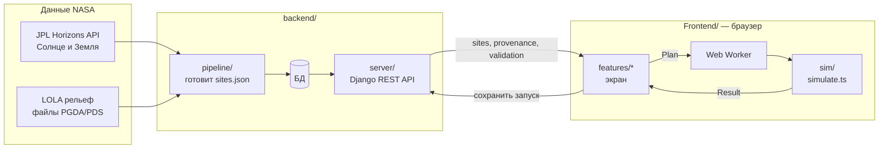

# Архитектура LAST LIGHT

> Папка `backend/` пока пустая — код загружает бэкендер. Пути `backend/...` ниже — согласованный план её структуры.

## 1. Общая картина



Простыми словами:

1. **pipeline** один раз (офлайн) скачивает данные NASA, считает горизонт и положения Солнца/Земли по часам и собирает `sites.json`. Команда `load_release` кладёт набор в БД.
2. **server** отдаёт этот набор по REST и хранит историю запусков для вошедших пользователей. **Физику сервер не считает.**
3. **Frontend** загружает набор, пользователь меняет план, `simulate()` считает результат **в браузере** (в Web Worker), экран рисует вердикт, сцену, таймлайн и объяснения.

## 2. Путь одного расчёта

```text
Пользователь меняет «Ёмкость батареи»
  → features/plan     planSlice: plan обновлён, revision + 1
  → app/listener      видит новый план → отправляет задачу в Worker
  → app/worker        sim.worker.ts вызывает simulate(site, plan)
  → sim/simulate.ts   168 часов: свет? Земля? заряд? → Result
  → features/result   resultSlice: сохраняет Result (если revision ещё актуальна)
  → features/*        Verdict, Scene, Timeline, Why — перерисовываются
  → features/runs     если пользователь вошёл — POST /api/runs/ (снимок Result)
```

## 3. Контракты (ТЗ, с. 2)

Они связывают команды. Меняются **только по согласию фронта и бэка**, с увеличением `version`.

```ts
SitesFile { version: 1, window: { start, stepH: 1, count }, sites: Site[] }
Site      { id, name, lat, lon, horizon: number[], horizonByMast?, horizonClones?, hours: Hour[] }
Hour      { t, sunAz, sunEl, earthAz, earthEl }          // азимут: от севера по часовой

Plan      { siteId, startIndex, durationH: 168, loadW, capacityWh, initialPct, minPct,
            panelW, maxBlackoutH: number | null, heaterW, mastM: 2 | 5 | 10 }
Result    { ok, hours: { sunlit, earthVisible, batteryPct }[],
            failure: { hour, reason: "battery" | "earth" } | null,
            kpis: { minBatteryPct, longestDarkH, longestBlackoutH, sunlitPct } }
```

Где лежат: JSON Schema — `backend/schemas/`, TS-типы — `Frontend/src/sim/types.ts`, Python-эталон — `backend/pipeline/lastlight/refsim.py`.

## 4. Кто за что отвечает

| Папка | Что внутри | Команда |
| --- | --- | --- |
| `Frontend/src/features/` | экраны и их логика, по одной папке на фичу | фронт |
| `Frontend/src/shared/` | общие кнопки, раскладка, API-клиент, переводы | фронт |
| `Frontend/src/app/` | Redux store, Worker | фронт |
| `Frontend/src/sim/` | **вся физика**: `simulate`, поиск даты, P1 | бэк пишет, фронт подключает |
| `backend/server/` | Django API | бэк |
| `backend/pipeline/` | данные NASA → `sites.json` | бэк |
| `backend/schemas/`, `sim/types.ts` | контракты | обе команды вместе |

## 5. Главные правила

1. **Одна физика.** Свет, Земля, батарея и отказ считаются только в `Frontend/src/sim/`. Компоненты и сервер ничего не пересчитывают.
2. **Компоненты не вызывают `simulate` напрямую** — только через Worker.
3. **Цифры не придумываются.** Тексты «почему» собираются из чисел `Result`.
4. **Время только UTC** (ISO 8601 с `Z`).
5. **Нет P1-поля в данных → элемент интерфейса скрыт.**
6. **Пока данные демо** (`provenance.mode ≠ "final"`) — на сайте метка `DEMO DATA`.
7. Неясно, как сделать? Не выдумывайте физику — допишите вопрос в раздел 7 ниже.

## 6. Принятые решения

1. **Расчёт в браузере.** `simulate.ts` в Web Worker; сервер физику не считает.
2. **Сервер.** Django + DRF + SimpleJWT + django-cors-headers; БД SQLite, при необходимости PostgreSQL. Отдаёт `sites`, `provenance`, `validation` по `datasetId`.
3. **Данные NASA.** JPL Horizons API (`requests`) для Солнца и Земли; LOLA DEM — файлы PGDA/PDS (`rasterio`, `pyproj`); горизонт — `numpy`. api.nasa.gov не используется.
4. **Две реализации расчёта.** TS (`Frontend/src/sim`) и Python (`refsim` в бэкенде) прогоняются по общим эталонным кейсам; при расхождении релиз данных блокируется.
5. **Аккаунты опциональны.** Без входа всё работает. Вошедшему пользователю каждый расчёт автоматически сохраняется в историю (замороженный `Result`), лимит 50 последних, видны только свои записи, можно переименовать и удалить. Восстановление пароля — по email.
6. **Ссылка на план** — в hash URL, при открытии план пересчитывается заново.
7. **Язык.** RU/EN, переключатель в шапке, хранится в `localStorage`; тексты «почему» собираются из словаря по `ruleId`.
8. **Семантика расчёта.** Порог в энергии без эпсилона; старт в 00:00 UTC с полным окном 168 ч; `heaterW > 0` без `capabilities.heater` → `FEATURE_UNAVAILABLE`; неизвестная площадка → `INVALID_PLAN`.
9. **Демо.** В демо-наборе все проверки уровней 1–4 — `pending`. Метка `DEMO DATA` скрывается только при `provenance.mode = "final"`.

## 7. Открытые вопросы

- [ ] Координаты двух площадок и окно времени.
- [ ] Как запросить у Horizons топоцентрические положения для точки на Луне — проверить тестовым запросом.
- [ ] Какие файлы LOLA (5 м/пикс, 240 м/пикс) и PGDA брать — конкретные URL.
- [ ] Предел дальнего рельефа для горизонта.
- [ ] Пороги состояний сцены (40 % заряда, 6 ч) — согласовать.
- [ ] Хостинг сервера и фронта.
- [ ] Email-провайдер для восстановления пароля.
